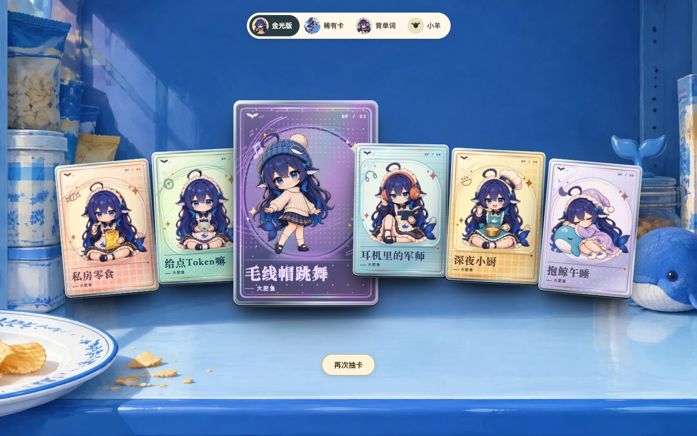
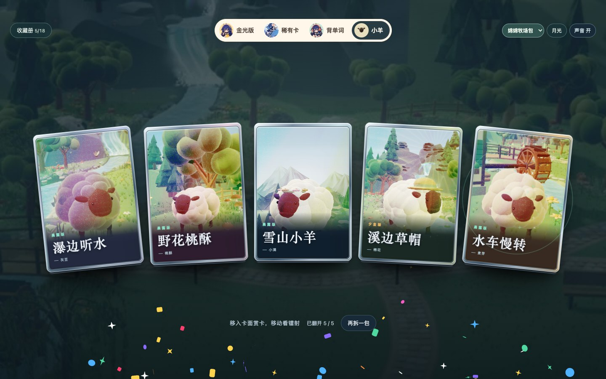

# 拆卡实验室

撕开卡包，看角色闪卡一张张弹出来。这里可以拆大肥鱼金卡、看骑鲸稀有卡、点读英语单词，也能收集绵绵牧场的小羊闪卡。项目使用 React、TypeScript、Vite 和 GSAP，在浏览器里运行。



## 本地启动

需要 Node.js 22.12 或更高版本。克隆仓库并启动。

```bash
git clone https://github.com/ChaoJiTuoLuKING/card-pack-lab.git
cd card-pack-lab
npm ci
npm run dev
```

终端显示 `Local:` 后，在同一台电脑上打开 [本地试玩](http://127.0.0.1:5176/?pack=whale&effects=gold)。保持终端里的服务运行即可访问。按 `Ctrl+C` 可停止服务，下次试玩时重新执行 `npm run dev`。

## 怎么玩

在顶部选择卡包。拖动封口、点一下封口，或聚焦后按 Enter 都能拆包。首次操作后可播放音效，按 M 可切换声音。

| 卡包 | 玩法 | 本地地址后缀 |
| --- | --- | --- |
| 大肥鱼 · 金光版 | 六张角色卡依次从金光中翻出，移动指针可看反光和角色动作。翻完后点「再次抽卡」可进入骑鲸隐藏包。 | `?pack=whale&effects=gold` |
| 骑鲸稀有卡 | 拆开隐藏包，靠近卡面看星光和角色反应。 | `?pack=rider` |
| 背单词 | 拆一包学一个词。点单词听发音，点例句听整句，点右侧角色重播动作。 | `?pack=english` |
| 绵绵牧场 · 小羊 | 六只小羊里每包随机抽五只。摇包可验光，第三次摇动触发星夜觉醒。翻开的卡会记入当前浏览器的收藏册。 | `?pack=meadow` |

手机上可用手指撕包、选卡和翻卡。小羊有晨露、夕金、星夜三种版本，共 18 款可以收集。



## 换成自己的卡池

- 英语词表在 [`src/card-pools/english.json`](src/card-pools/english.json)。每条填写 `word` 和 `meaning`，可以加上 `example` 和 `translation`。词条按文件顺序循环。未提供录音时，使用浏览器的英语语音。
- 小羊和大肥鱼角色分别在 [`meadow.ts`](src/card-pools/meadow.ts) 和 [`whale.ts`](src/card-pools/whale.ts)。把角色图片放进 `src/assets/`，按已有条目填写。保留原卡片的 ID 和版本可以延续浏览器中的收藏记录。

## 构建与检查

```bash
npm run typecheck
npm test
npm run build
npm run preview
```

构建结果在 `dist/`。运行 `npm run preview` 后，可打开 [构建预览](http://127.0.0.1:6176/?pack=whale&effects=gold)。

## 源码入口

- [`App.tsx`](src/App.tsx) 管理选包、抽卡、翻牌和收藏。
- [`Pack.tsx`](src/Pack.tsx) 和 [`seal.ts`](src/seal.ts) 处理封口拖拽、撕裂与回弹。
- [`FoilCard.tsx`](src/FoilCard.tsx) 和 [`cardFlight.ts`](src/cardFlight.ts) 负责卡面、镭射反光和出卡动效。
- [`RiderPack.tsx`](src/RiderPack.tsx) 和 [`DailyCard.tsx`](src/DailyCard.tsx) 分别处理骑鲸稀有卡和日常卡，其中包含英语点读。

## 许可证与致谢

源代码采用 [MIT 许可证](LICENSE)。部分撕包、全息材质、粒子和音效代码改编自 [prism-holo-pack](https://github.com/Lone3m-tech/prism-holo-pack/tree/5a94862acf3c9dda65fcb928b57d31867312484f)，版权声明见 [第三方声明](public/THIRD-PARTY-NOTICES.txt)。角色插画、配音和演示视频适用各自的授权。
